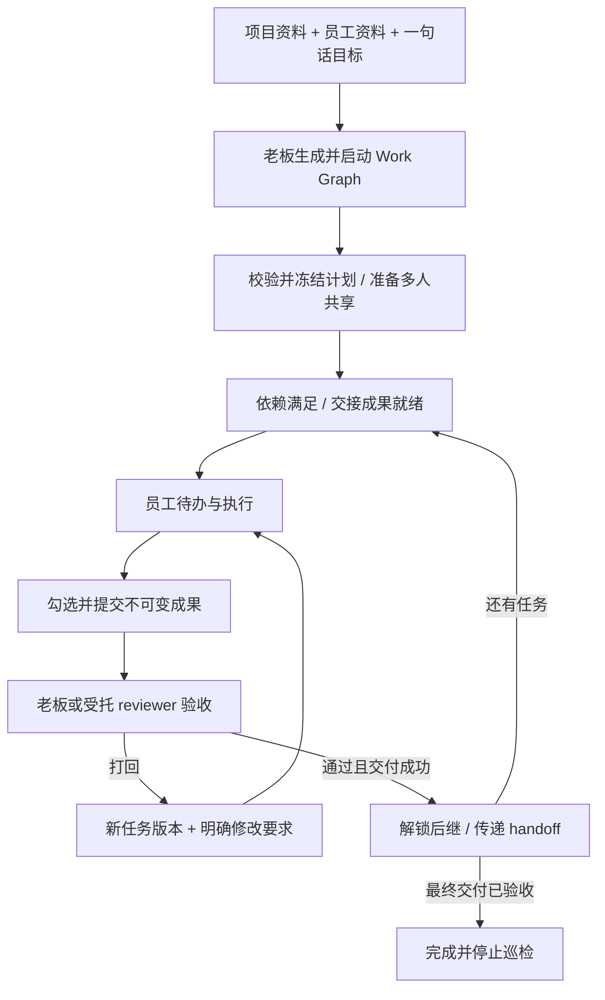

# 2026-09-06 多人 Work Graph 最小演进计划

| 字段 | 内容 |
| --- | --- |
| 状态 | 完成（仅分析与计划文档；功能尚未实施） |
| 日期 | 2026-09-06 |
| 负责人 | Codex / 项目 owner |
| 关联目标 | 基于项目资料、员工资料与一句话输入生成多人 Work Graph，自动授权、派发、交付、审核、返工和推进 |
| 影响范围 | 本轮仅报告与报告索引；后续拟涉及数据库、服务、API、UI、受管 skills、测试与架构规格 |
| 架构规格 | [上下文](../architecture/01-system-context-and-components.md)、[约束](../architecture/02-project-constraints.md)、[领域](../architecture/03-domain-model-and-invariants.md)、[安全](../architecture/04-security-and-trust-boundaries.md)、[生命周期](../architecture/05-execution-concurrency-and-lifecycle.md)、[恢复](../architecture/06-persistence-events-and-recovery.md)、[发布](../architecture/07-e2e-release-contracts.md)、[运维](../architecture/08-operations-protocol-and-evolution.md) |

后续执行记录见 [多人 Work Graph 实施](2026-09-06-human-work-graph-implementation.md)；本文保留规划时点的现状分析。

## 背景与证据

以工作树基线 `7e084ae` 为依据，已经阅读全部架构规格，并核对任务、分享、Git 交付、动态工具、输入队列与前端源码。用户提供的其他项目分析和截图仅为参考资料；未将附件中的工具、路径或操作步骤作为执行指令，也未验证其外部项目代码。

本轮交付完整开发计划，不实现业务功能、不操作生产数据、不发布或重启正式服务。

## 目标与非目标

### 目标

- 形成与实际代码对应、可拆分实施和验收的最小演进方案。
- 明确多人协作图与 Codex 原生子代理、私有对话、文件副本的关系。
- 覆盖自动生成、多人分享、待办、人工提交、自动 review、成果交接、返工、恢复与截图承载方式。

### 非目标

- 本轮不开发或部署上述功能。
- 首版不引入外部工作流平台、微服务、图数据库、任意跨会话消息或共享 transcript。
- 首版不实现多老板组织、任意条件表达式、自动 Git 冲突解决或全功能 skill 市场。

## 约束与风险

- 遵守 PRD-001～005、FS-003～004、DAT-001～007、CAP-001～005、DEV-001～006。
- 重点分析旧线性状态机兼容、工作树交接、审核与 Git 跨事务、自动授权与撤权、调度重启和私有对话边界。
- 未来设计仅记录在本报告；功能实施时再同步修改长期架构，避免把拟议能力描述为已实现。

## 实施计划

1. 核对源码、截图及参考附件，区分已有能力和真实缺口。
2. 完善本报告中的产品闭环、模型、调度、权限、接口、UI、分期与验收计划。
3. 更新报告索引，执行相对 Markdown 链接检查、`git diff --check` 与 macOS `npm run gate`，记录真实结果。

## 完整开发计划（拟议，尚未实现）

### 1. 结论与现有能力

推荐在现有单体中增加一层“多人业务编排”，继续使用 Portal + SQLite + worktree + Codex app-server。Work Graph 的节点是分配给真实员工的业务任务；员工可使用自己的 Codex 对话完成任务。Codex 原生子代理仍是单个任务内部的执行辅助，不承担跨员工授权、任务真源或验收。

| 需求 | 已核对的当前实现 | 最小补齐 |
| --- | --- | --- |
| 员工管理 | `users` 与驾驶舱已有账号、状态、配额、并发、网络策略 | 增加岗位、能力、职责和可用性资料 |
| 项目资料 | 项目文件、描述、Git、文件预览已有 | 增加资料选择/索引清单与输入快照；首版不建向量库 |
| 多人 Share | 已允许一个项目多个 active 员工，各有独立 access/worktree | 提取分享服务，支持图启动时批量、幂等准备和自动授权 |
| 任务看板 | `public/index.html`、`renderTasks()` 已有任务首页与状态卡 | 同一页面增加老板项目图和审核抽屉，员工增加 checklist 与交付卡 |
| 工作流 | `createRoadmap()`、`activateRoadmap()`、`reviewSubmission()` 是按 position 激活下一步 | 支持依赖图、并行分支、汇合与持久推进 |
| 提交/审核 | 不可变 Git submission、passed owner merge、rework 版本递增已实现 | 人工提交、结构化验收意见、自动 reviewer、DAG 后继调度 |
| 定时任务 | 有输入 FIFO 的 250ms pump、SSE 心跳和容量 lease 心跳 | 缺少业务 job、到期检查、崩溃补偿与 review 调度；输入队列不是工作流定时系统 |
| Skill | 已有受管 `task-execution` 与注册、发现、注入 | 加 planner/reviewer skill 及受限业务工具，不重建插件平台 |
| 同项目通信 | task/submission 已传递部分事实；私有 chat 隔离 | 加显式 handoff、review feedback 和项目事件，不共享原生 thread |

源码证据入口：[数据库](../../src/db.mjs)、[HTTP 路由](../../src/server.mjs)、[Git 服务](../../src/worktree-service.mjs)、[Codex 服务](../../src/codex-service.mjs)、[私有输入队列](../../src/input-queue-service.mjs)、[任务前端](../../public/app.js)、[驾驶舱](../../public/boss.js)、[受管任务 skill](../../portal-skills/task-execution/SKILL.md)、[任务测试](../../test/task.test.mjs)、[发布 E2E](../../test/e2e/portal-gate.test.mjs)。

特别注意三个现状：

1. 当前 `/api/tasks` 按 assignee 返回；老板打开截图中的“我的任务”看不到自己派给员工的汇总，不能只换页面标题，必须增加 owner 图查询。
2. `task_submissions` 的 native thread/turn/item 字段目前是 NOT NULL，提交要求来自完成的 Codex turn。纯人工勾选不能直接复用为已验收，需要显式增加人工交付路径。
3. 当前 passed 把员工成果合入 owner 后只激活下一人，没有把 owner 新成果同步到下一人的旧 worktree；E2E 验证了 owner 收到文件和下一任务激活，未证明下一人拿到了前序产物。

### 2. 预期产品闭环

1. 老板在驾驶舱维护员工资料；在自己拥有的项目中选取资料并输入一句话目标。
2. 点击 EXECUTE，创建持久的生成请求；planner 读取当前项目资料与候选员工能力投影，返回结构化计划。
3. Portal 校验依赖、员工、验收标准和预算，保存不可变计划版本。默认允许老板编辑预览后启动；也提供一次操作的“生成并启动”，其入口明确包含自动分享、派发和该图 review 授权。不能把每轮员工返工变成一次老板重复确认。
4. 图进入 preparing：为计划涉及的全部员工准备共享；全部准备成功再发布本批新授权与图的运行状态。已授权成员复用原 access。暂不可执行的节点可显示“等待前序”，只有就绪节点进入可操作待办。
5. 员工在“我的任务”及该项目中看到任务目标、checklist、验收标准、输入成果、截止时间和当前轮次；可进入任务 Codex 对话或人工工作。
6. 员工勾选 checklist，填写成果说明、选择交付文件，点击“提交验收”。勾选仅表示自报完成；只有提交会生成不可变 submission，状态进入 submitted。
7. 提交事务同时写入 review job；关闭浏览器不影响处理。自动 reviewer 或老板读取固定提交、验收标准和上游输入，形成逐条意见。
8. 通过：先交付固定 Git 快照到 owner，再记录审核通过，生成受 ACL 的 handoff，推进所有依赖满足的后继。打回：保留旧 submission 与意见，task.version + 1，形成新轮次 checklist，员工收到“深化/重做”待办。
9. 最终汇总交付节点也必须验收通过，且所有必需节点通过，图才完成。完成后停止该图的周期检查，保留图、交付与审核历史。

共享的是同一个逻辑 Project。员工端看到的是该项目的授权视图和独立文件副本，不另外创建互不关联的“员工项目”。派发待办默认不自动启动员工 Codex；员工点击执行才消耗其运行容量。



### 3. 数据模型：保留 Task，分开计划、运行和模型调用

保留 `roadmaps` 作为工作包容器，新增 `kind=linear|dag`；现有记录默认 linear，旧接口和线性 release contract 保持。Graph 的计划版本不可变，运行状态不能覆盖定义，Codex turn 不能替代业务任务。

```text
Project -> Roadmap(kind=dag)
           -> GraphPlanVersion(冻结节点、依赖、验收和资料引用)
           -> WorkflowRun(绑定一个 plan version)
               -> Task(node_key + workflow_run_id + task.version)
                   -> Submission(kind=codex|manual)
                   -> TaskReview / TaskHandoff
               -> WorkflowJob -> optional TurnRun(planner/reviewer)
```

按阶段增加七张职责明确的小表；避免独立复制一套 graph task 或通用 BPM 引擎：

| 拟议表 | 关键内容与不变量 |
| --- | --- |
| `employee_profiles` | user_id 唯一、岗位、职责、skills/tags、交付偏好、可用性、能力说明、revision、updated_by；只供管理员维护和按用途投影 |
| `graph_plan_versions` | roadmap_id + plan_version 唯一；schema_version、graph_json、资料/员工版本引用、source_request、created_by；已启动版本不可原地编辑 |
| `workflow_runs` | plan_version_id、project/owner、状态、revision、generation、启动授权范围、review_policy、预算、paused_reason；首版每项目最多一个活动 DAG run |
| `workflow_jobs` | type、run_id、task/submission/version、dedupe_key、due_at、status、lease_token/until、attempt、error_code、关联 turn_run_id；保存执行意图与恢复凭据 |
| `task_reviews` | submission、task_version、人工/AI actor、rubric 版本、逐项结果、修改要求、suggested/applied/superseded、幂等键；每轮不可覆盖 |
| `task_handoffs` | 来源 submission 与 delivery SHA、成果相对路径/hash、结果摘要、限制、输入版本；受 project 与依赖关系 ACL 控制 |
| `project_events` | 单调 cursor、project/run/task、事件类型、recipient/audience、资源引用、时间；仅安全元数据，正文经原资源 ACL 查询 |

对现表做兼容扩展：

- `roadmaps`：kind 与当前 workflow 引用。DAG 的详细运行态以 workflow_runs 为准；旧 status 仅作兼容投影，不再由任意一个并行节点 submitted 覆盖全图状态。
- `tasks`：nullable workflow_run_id/node_key、due_at、checklist_json、checklist_revision、blocked_reason、输入基线/上下文 manifest 引用。`UNIQUE(workflow_run_id,node_key)` 保证一节点一任务；同一任务多轮沿用现有 version。
- `task_submissions`：kind、result_summary、checklist_snapshot、outputs_manifest、idempotency_key。codex 提交保留原有绑定校验；manual 提交将三个原生身份列迁移为 nullable，并增加 kind 对应约束，禁止伪造 thread/turn/item。
- `chats` 或运行上下文：purpose=normal|planner|reviewer、workflow/job 关联；内部后台运行由持久授权记录绑定 owner 和项目，不保存或复用浏览器 Cookie。
- 项目资料清单先随计划保存相对路径、Git tree/hash、显式选取范围；内容仍由受 ACL 文件/Git 服务提供。员工资料只保存所用字段快照与版本，不把全公司敏感备注复制给员工。

首版图拓扑存于不可变 graph_json，任务映射按 node_key；小规模 DAG 无需新建节点表、边表或引入图数据库。建议首版新图限制 32 个业务节点、96 条边，这是容量起点，并非照搬附件作为强制标准；旧线性 1–100 步契约不变。

### 4. 图契约、状态与返工

首版仅支持真实员工工作节点，节点内带验收阶段；前端可画出 review 状态，数据库不另建重复 REVIEW task。允许并行、依赖汇合，使用虚拟 START，要求一个最终交付节点 `completionGate=true`，所有必需节点能到达它。一个节点也可构成完整图。

确定性校验包括：schema/大小限制、唯一 node key、引用存在、无自依赖/重复边、拓扑无环、完成节点可达、员工 active、标题/checklist/验收标准与输出要求齐全、所有引用属于本项目。生成阶段检查候选员工；启动阶段复验实际授权和配额。多负责人任务拆为多个员工节点加汇总节点，不改变现有单 assignee 的 Task。

```text
计划：生成中 -> 已校验草稿 -> 冻结版本
运行：preparing -> running -> passed
                  <-> paused -> cancelled / superseded
任务：ready -> active -> submitted -> passed
                         -> rework(version + 1) -> submitted
```

ready 的等待原因可为前序、员工、配额或成果同步；active 表示已派发，可另投影 Codex 是否在跑。模型 completed、员工勾选、提交成功、AI建议通过、Git交付成功、业务 passed 是不同事实。

- 就绪条件：全部上游 passed 且有交付凭据；handoff 可读取；当前 employee/access 仍有效；输入基线准备成功；不存在同一 access 的其他未验收图节点。
- 打回只作用当前 pending submission，保留原清单快照和意见；失败项默认取消勾选，已通过项可带来源保留，新要求加入新版本。旧 task chat 不能交付新版本。
- 多分支中一个节点返工，已无依赖关系的分支继续；其后继继续等待。当前版本仍未验收，不需要在 DAG 中画回边。
- DAG 将“当前节点交付通过”和“后继可派发”分开：后继员工失去权限时阻塞该后继，不撤销已经合法完成的上游交付。此为新增 DAG 语义；旧 linear 的当前/下一 assignee 审核校验保持原样，实施时同步领域规格和新增测试。
- 首版不提供已 passed 节点原地退回；需要改变已验收工作或拓扑时暂停原 run，生成修订计划并创建新 run，旧成果作为显式、已验收输入引用。不得静默使已启动后继继续使用失效输入。
- 最终节点提交未通过时正常返工；最终节点通过后全图完成，不在完成后追加一项隐式审批。

### 5. 员工资料、项目资料与一句话生成

驾驶舱“管理员工”扩展业务档案：岗位、职责范围、能力标签、熟悉工具、交付形式、可用性/休假、业务任务并行上限。账号并发与业务负载分开：能开多个 Codex turn 不代表能同时承担多个工作节点。首版沿用一个管理员角色；档案中的“角色”不授予 Portal 权限。

项目生成入口提供当前项目、资料范围、候选员工、目标、可选截止时间和 review 模式。资料优先使用老板选取的文件与项目说明；受控读取、按文件/总量预算截断并展示未读取项。先做目录索引与确定性检索，不要求向量数据库。对不能解析的资料显示“未用于生成”，不能声称已经理解。

planner 输出严格 JSON：节点、assigneeUserId、dependsOn、checklist、acceptance、input/output contracts、dueAt、completionGate 与假设/待补信息。服务端生成 id、校验和保存；不从自然语言最终回复猜测任务状态。模型不能直接写 SQLite 或任意授权员工。低置信匹配、无人可做或资料缺失进入可编辑草稿，显示具体缺项；有可用默认值时继续完成草稿，不中断为一连串对话确认。

EXECUTE 两种入口共用同一生成服务：“生成预览”供老板编辑；“生成并启动”在选定员工范围及策略内自动校验、分享、派发。后者若校验失败留在草稿并给出修正入口，不启动部分图。生成本身也有 job/request id，刷新和重试不产生重复计划。

### 6. 批量自动分享与既有分享语义

现有 share 会复制老板已有全部对话历史。若直接用于自动生成图，会把规划对话中引用的员工资料也带入员工副本。因此建议为分享服务增加显式范围：

- 现有手动分享默认继续 `files_and_history`，保留 E2E-008 的一次性完整历史 fork。
- Work Graph 自动分享采用 `files_only`：共享项目文件基线与业务任务，通过结构化任务简报给上下文。UI 展示实际范围；不隐式修改已有分享副本。
- 该范围只控制是否 fork chat，不提供项目文件分级权限；获分享员工仍获得整个项目文件基线的访问能力。不能承诺员工只看到自己节点的文件。

把当前路由逻辑提取为 `ProjectShareService`，由 HTTP 和 workflow job 共用：

1. 固化本次执行授权的员工名单、scope 和 generation；active share 跳过，retained access 按原规则恢复，缺失者预分配 access id。
2. 检查 owner 权限、各员工状态、项目数/存储与各保留树；在 owner 分享屏障内固定一个 baseline，对本批新成员准备 worktree，禁止跨异步窗口漏掉授权复验。
3. 耗时文件/Git操作与隐藏准备记录分开，不能跨 await 持有 SQLite 写事务。准备记录供重启后识别未绑定 tree。
4. 全部准备成功，短事务发布本批新/恢复 access 与 workflow ready；随后派发就绪待办。部分失败不发布本批新授权，原 active share 保留；清理仅限该准备批次的未绑定干净资源，保留脏树与可诊断记录。
5. 授权后某人被撤权/停用时，暂停有关节点与未来派发。后台巡检绝不能把老板刚撤掉的 access 自动恢复；重授权必须是新的明确业务操作。

一次执行最初已授权的完整员工名单均获得项目访问，后续依赖只控制何时能执行待办。后续新增 assignee 超出该授权名单时需要老板在修订计划中明确新增授权。

### 7. 成果交接与 worktree 同步

不能只把 task B 改成 active。员工 B 的 worktree 可能仍在最初 share 的旧基线，必须建立可验证输入：

1. A 的固定 submission 通过并合入 owner，记录 delivery SHA。
2. Portal 为 B 创建输入 manifest：上游任务/版本、submission、delivery SHA、允许成果路径、hash、摘要、限制和验收标准。
3. 在 B access 空闲时，将所需已验收 owner 基线安全合入 B 的独立 worktree，并记录本节点 input_base_sha 与 manifest 版本；汇合节点使用包含全部必需上游的确定 owner commit。
4. B tree 有未提交工作、运行/输入队列占用、来源不清的本地提交或 merge 冲突时，标记“等待成果同步/需处理冲突”，不覆盖、不 reset、不 auto-stash。提供同步重试和老板处理入口。
5. 只在基线与 manifest 都确认后激活 B。文件已经是相同 commit 的 ancestor 或同 hash 时幂等成功；断点后可重算收敛。

Git owner merge 仍须同时满足 owner 与原 assignee access 空闲。多名员工可并行产出；owner 交付在服务端按项目串行，避免两个 review 同时合并 owner。代码/文件交付和数据库不是一个事务，应保存阶段记录、使用 ancestry/hash 复验，Git 成功但 DB 未更新时重试完成剩余记录，不能生成第二次业务通过。

最小版本保留每个员工一个 worktree，因此业务调度同一 access 一次只放行一个未验收图节点，直到它通过或取消；不同员工并行。现有普通 chat 并发不全局收紧。如果员工在图节点期间还运行无关 chat/修改，标记交付来源需核对，阻止无人值守自动通过；submission 仍是整个 worktree 快照，不宣称任务级隔离。检测到无关运行/基线漂移时要求检查交付清单，不能靠模型声称“只做了本任务”消除风险。需要同一员工多任务真正并行隔离时，第二阶段再引入每任务 execution environment/worktree。

首版 handoff 使用 Git 中的项目文件和结构化说明，不建设外部产物存储。受信服务按授权 commit/相对路径提取和验证，复用保留路径、symlink/submodule 拒绝与文件大小限制；不能把宿主路径或 `.git` 暴露给模型。单纯会外执行的工作，也可提交一份人工结果说明文档和现有文件快照。

### 8. 提交、review 与自动执行边界

员工提交提供两种来源：

- Codex：继续验证当前 task.version、员工、access、task chat、completed turn、final item，固定文件快照。
- 人工：当前员工在 active/rework 任务中填写结果说明、checklist、成果引用，固定同样的 Git commit/tree。native 身份为空且 kind=manual，不制造假 Codex 证据；至少存在结果说明或要求的文件，不能空勾选通过。

任务 checklist PATCH 和提交使用 expected task version + checklist revision + idempotency key；重复点击返回同一提交回执，版本过期返回 409。提交保存当轮清单与说明，后续编辑不能改变老板正在审核的证据。

review 策略按图冻结并可显式修订：

| 模式 | 行为 |
| --- | --- |
| manual | 老板直接判定；调度器负责同步任务和推进 |
| assisted | AI生成逐项验收建议，老板应用结果；适合初期验证审核质量 |
| auto | 老板启动时授予该图自动验收/打回权，受预算、rubric 和版本围栏约束；符合条件时自动闭环 |

最终交付节点可单独配置 manual 或 auto；这在启动时可见。开发先完成 assisted 以验证证据链，目标功能包含 auto，不能把“只能人工审核”的中间版本宣称为用户要求的完整交付。

reviewer 读取 task/rubric、不可变 submission 与上游 handoff，输出逐条验收结论、证据引用、缺项和具体修改要求；不读取员工完整私有对话，不以员工自勾清单等同验证。首版自动检查可覆盖必需成果存在、hash/格式、结构化验收条款与内容评审。员工报告“测试通过”属于来源明确的证据陈述；需要独立执行验证的标准，必须有受信验证器在固定候选快照的隔离临时环境验证，否则转人工或保持待验收，不能自动宣称独立检查通过。

模型只提交 review proposal。Portal 检查 delegation、版本、输出结构、权限和必需证据后应用。`passed` 要求 Git 交付已成功；冲突仍 pending。`rework` 要有可执行修改要求。无法判断、证据缺失、超额或连续返工达到建议默认 3 轮时进入需老板处理，保留继续入口。首版不自动执行对外发布、付款或外部账号操作。

关键生命周期：review 模型在 owner access 上运行时，不能在自身动态工具调用里同步等待 owner merge，因为现有空闲屏障会被自己的 turn 占住。工具先保存建议和 apply job，待 reviewer turn 终态并完全释放 lease 后，job 才获取交付屏障并应用结果。手动审核与 AI 审核共用服务与 CAS；人工先处理后，迟到 AI 建议标为 superseded，不覆盖新轮次。

### 9. 持久化调度：事件触发 + 周期补偿

新增 `WorkflowScheduler`，由 Portal 进程启停，SQLite 保存 job。首版无需 Redis、外部 cron、Temporal 或 Codex 桌面自动化功能。进程内 timer 只唤醒扫描，数据库是恢复依据；浏览器关闭后继续工作，但 Mac 休眠/Portal 离线期间无法执行，恢复时按 due_at 补查。

- 提交、审核、分享准备完成、handoff 就绪等业务事务同时写 job 与语义事件，然后异步唤醒；正常路径不等定时轮询。
- 建议初值：每 30 秒扫描到期 job/丢失推进意图，每 5 分钟检查逾期和等待过久节点。无状态变化时只查 DB，不启动模型；UI 显示最近检查与下次检查时间。
- job 类型：plan.generate、share.prepare、task.dispatch、submission.review、review.apply、handoff.prepare、workflow.reconcile、task.overdue。按 due_at/status 建索引，限制每批大小。
- CAS 抢占，lease + heartbeat，指数退避与最大重试，失败进入 needs_attention；SQL 事务内同时更新任务事实、事件与下一步 job。每次执行都重查 user/access/generation。
- 幂等键包含 run/node/task.version/submission/action；调用重投允许，但任务、审核应用、通知事实不能重复。不能宣称跨 SQLite、Git、native RPC 的分布式 exactly-once。
- native 调用前持久化 job 与 turn 关联；回报需匹配 workflow generation、task version、submission、job lease 与实际 turn。超时/取消后迟到结果不改变新状态。
- 重启继续遵守 DAT-005：旧 active native run 变 interrupted，输入队列暂停；workflow scheduler 只重建持久业务意图，不将旧 native run 冒充继续成功。结果不确定的外部调用不盲重发；先对账，不能确认则转需处理。
- 新建后台 reviewer turn 可在有效的 workflow delegation 下恢复调度，并使用新的 turn id；这是后台 job 的明确策略，不能自动继续用户已暂停的输入队列。
- 所有 planner/reviewer 使用现有 CapacityService，计入老板用户限额、Portal 11 root 与 EXECUTE 配额；建议后台模型默认只允许 1 个并发，为交互保留机会，超额排队。WAITING_HUMAN 不占模型席位。
- 暂停/取消会阻止新 job 派发并排空已运行的模型；图完成停止周期工作。停用、改密和网络策略变化按现有安全语义中断，并暂停相关后台授权，不能靠无 Cookie 内部调度逃过账号生命周期。

看板显示业务原因码而非 raw error：等待前序、等待员工提交、等待执行资源、等待验收、等待成果同步、合并冲突、权限失效、服务离线、连续失败需处理。审计和事件只保存 ids/状态/安全计量；prompt、成果正文和审核全文放在受 ACL 的业务记录中。

### 10. Skills 与受限业务工具

扩展现有受管技能目录：新增 `work-graph-planning`、`work-graph-review`，增强 `task-execution` 读取任务简报与上游成果。服务端按 purpose 校验精确 skill 路径和版本，并复用既有发现失败 fail closed 机制；不安装任意外部 skill，不放开现有 Codex 工具禁用项。

| 调用上下文 | 最小工具范围 |
| --- | --- |
| planner | 当前项目资料、候选员工能力投影、`work_graph_submit_plan` |
| employee task | 当前任务简报、允许上游 handoff、既有 workspace 工具；员工勾选/提交仍由员工 UI 发起 |
| reviewer | 固定 submission/任务/rubric/允许成果读取、`work_graph_submit_review` |
| Portal scheduler | 直接调用受 ACL 的业务服务执行派发/分享/审核应用；不由模型获得通用 admin 工具 |

工具名字是拟议接口，正式实现时统一 schema。身份从受管 active turn/job 上下文反查；不信任参数里的 owner/project/employee/thread 身份。新业务工具同时做 schema 和服务端 scope 校验。reviewer 默认不给文件写入或 shell；planner 不能自行扩大候选员工名单或权限。原生子代理不得自动继承 planner/reviewer 的业务写工具，提交计划/建议限定绑定 root；普通项目文件和附件不能扩权。

Skill 说明“怎么规划、怎么验收”，工具和数据库实现“能做什么、结果是否生效”；不能靠修改 SKILL.md 代替调度器或状态机。

### 11. 同项目通信与可见性

首版做结构化通信即可完成需求：下发任务简报、员工成果 handoff、老板逐项意见、返工要求、派发/通过/逾期/权限异常事件。

- 老板：只读自己拥有项目的图、任务、交付与审核记录，不因为 admin 自动读其他项目内容。
- 员工：自己的任务、提交、返工意见；已授权项目图可展示最小节点/负责人/状态摘要；仅依赖链明确发布的已验收 handoff 提供成果正文。其他人的原生 chat、未交付草稿和员工档案备注不公开。
- 项目级 SSE 重新按 project/access 和事件 audience 授权；复用 cursor 重放思路，不能直接复用私有 run SSE 或把 raw audit 全量广播给成员。撤权即停止投递，重连重新鉴权。
- 首版“收件箱”从当前需处理任务与审核事实推导，可在刷新/重启后恢复，不承诺逐条消息未读同步。摘要状态更新不等于把内容注入员工原生 thread。
- 第二阶段如需澄清提问，再增加 `project_messages`（task-scoped question/reply、附件引用、recipient）与已读回执；通过 Portal broker 传递，不裸用 thread injection，不建通用企业 IM。

### 12. 用截图承载老板 Work Graph

沿用截图的黑色背景、荧光绿强调、顶部导航、大标题、四张统计卡与下方主体区域，复用现有静态 HTML/CSS/JS。首版不迁移 React，不建设新的独立驾驶舱。

| 截图位置 | 老板视角调整 | 员工视角 |
| --- | --- | --- |
| 任务首页 / 工作台 / 驾驶舱 | 任务首页默认“项目推进”，工作台继续文件和 Codex，驾驶舱维护员工/账号 | 保留我的任务、工作台 |
| “我的任务”大标题 | “项目推进”，旁边项目选择与图版本；未选项目展示自己项目概览 | 继续“我的任务”，可按项目筛选 |
| 标题下说明 | 目标输入 + 资料范围 + 员工范围 + EXECUTE；展示生成/校验/分享准备进度 | 提交后仍待验收的说明 |
| 四张统计卡 | 进行中、待验收、需返工/阻塞、已完成；显示“通过节点/总节点”，不把自勾完成计入 | 进行中、待验收、需返工、已通过；项目数移到筛选器 |
| EXECUTE 并发 | 保留 0/11 运行资源卡；增加后台排队、巡检状态与暂停入口 | 保留资源状态 |
| “LINEAR ROADMAP / 交付队列” | 改为 WORK GRAPH；图视图/按状态列表/事件记录切换 | 项目分组 todo 卡与 checklist |
| 主体空白区域 | 左侧到右侧按依赖层级排布节点，连线表达前序；节点显示员工、轮次、截止时间和原因 | 每张卡显示验收标准、上游成果、勾选、提交和返工意见 |
| 点选节点 | 右侧详情/验收抽屉：输入输出、固定成果预览、清单、审核建议、通过/打回 | 打开任务对话、成果、提交回执 |

布局草图：

```text
任务首页       工作台       驾驶舱                      Codex 0/11
项目推进  [当前项目 v1]            [目标输入 ……] [EXECUTE]
[进行中 2]     [待验收 1]     [返工/阻塞 1]     [已通过 3/8]
[图视图 | 状态列表 | 事件]              [暂停] [最近检查]

                         [员工乙：设计  进行中]
[员工甲：需求 已通过] ────┤                      ├──[员工丁：汇总交付]
                         [员工丙：实现  待验收]

点选节点 -> 详情抽屉：验收清单 / 成果 / 本轮意见 / 历史版本
```

先做按拓扑分层的 DOM 卡片 + SVG 连线，支持缩放/滚动、选中高亮依赖；首版不做自由拖拽连线画布。草稿用表单改负责人、依赖和验收标准，启动后拓扑只读。小屏默认层级列表；不能只靠颜色区分返工、待审和完成。新建页面以角色与 project owner 判断展示，前端隐藏不替代后端权限。

### 13. 服务改动与拟议接口

| 改动位置 | 工作内容 |
| --- | --- |
| `src/db.mjs` | 幂等 schema；旧 task 提交/审核复用；增加 graph/review/job/event 事务方法，显式区分 linear 与 dag |
| 新 `src/work-graph-service.mjs` | 计划校验、运行、就绪计算、派发、暂停/取消与业务版本 |
| 新 `src/workflow-scheduler.mjs` | DB job、lease、退避、恢复、巡检与后台容量策略 |
| 新 `src/task-review-service.mjs` | 提取原 review/owner delivery 路由流程；人工与 AI 共用，DAG 不调用旧 position 推进 |
| 新 `src/project-share-service.mjs` | 提取既有 share/restore，增加准备批次、scope 与失败恢复 |
| 新 `src/project-context-service.mjs` | 员工/项目资料投影、submission 与 handoff 读取和基线准备 |
| `src/worktree-service.mjs` | 安全同步 owner 已验收成果到员工、输入 SHA 与断点幂等；保留现有交付/冲突行为 |
| `src/codex-service.mjs` | purpose/skill/tool scope、job/run 绑定、规划/审核结果与终态通知；复用当前 capacity 与中断 |
| `src/server.mjs` | 轻路由/ACL/参数校验、图/待办/项目事件 API；不能复制另一套 share/review 授权逻辑 |
| `public/index.html`、`public/app.js`、`public/styles.css` | 截图上的老板图与员工 checklist，可将独立渲染提取为 `public/work-graph.js` |
| `public/boss.html`、`public/boss.js` | 员工能力资料表单与自动化状态概要 |
| `portal-skills/`、`test/` | 两个受管 skill、任务 skill 增强、状态/恢复/API/UI 测试 |

建议 API（未来契约，不是当前可调用接口）：

| 接口 | 用途 / 约束 |
| --- | --- |
| `GET/PATCH /api/admin/users/:id/profile` | 管理业务资料，revision 防止覆盖；不修改账号角色 |
| `POST /api/projects/:id/work-graphs/generate` | owner、输入范围、reviewPolicy、幂等键；返回 generation request/job |
| `GET /api/projects/:id/work-graphs` | owner 完整视图 / member 安全摘要，分页 |
| `GET/PATCH /api/work-graphs/:id/plan` | 当前草稿与新版本；expectedVersion，运行中禁止覆盖冻结定义 |
| `POST /api/work-graphs/:id/start` | expectedPlanVersion + 幂等键 + 授权范围；异步 preparing |
| `POST /api/work-graphs/:id/pause|resume|cancel` | owner、expectedRevision；处理中断和旧结果围栏 |
| `GET /api/work-graphs/:id` | 按角色返回当前 run、节点、阻塞、审核策略、检查时间 |
| `PATCH /api/tasks/:id/checklist` | assignee/current access、taskVersion/checklistRevision |
| 扩展 `POST /api/tasks/:id/submissions` | codex/manual、固定快照、idempotency；旧请求语义保留 |
| 扩展既有 `POST /api/admin/task-submissions/:id/review` | 人工意见、逐项结果和 expectedVersion；统一 review service |
| `GET /api/tasks/:id/handoffs` | 依赖链发布的已验收成果、当前 access 复验 |
| `GET /api/projects/:id/events?after=...` | 受 ACL 的项目 SSE/journal；正文按原资源查询 |

所有写请求保留 session/CSRF/Origin 校验；内部 job 使用 workflow delegation 与当前 ACL，不伪造 Web 会话。旧 linear API 不得激活/推进 dag，错误路由返回明确冲突。公开响应继续隐藏 treePath、内部凭据和原生执行身份。

### 14. 分阶段计划、依赖与完成标准

以下为一名熟悉本仓库的全栈开发者的粗略工程估算，包含针对性测试与常规联调，不是承诺日期；真实模型验收质量、Git 边界问题和产品调整会影响工期。按顺序实施，无需新增基础设施。

| 阶段 | 交付 | 验收条件 | 估计 |
| --- | --- | --- | --- |
| P0 基础边界 | service 提取、迁移方案、线性兼容、授权/任务版本梳理 | 旧 gate 原样通过；share/review 无行为回退 | 2–3 人日 |
| P1 人员与生成 | 员工资料、项目输入 manifest、planner skill、计划 schema/草稿与截图入口 | 一句话生成可编辑 DAG，错员工/环/资料缺项可诊断 | 3–5 人日 |
| P2 多人手工闭环 | 批量 files_only 分享、DAG 任务、checklist、manual/codex submission、人工 review、handoff 同步与事件 | 至少三名员工的分叉/汇合与一次返工完成；下游确实读到上游文件 | 5–7 人日 |
| P3 自动验收与恢复 | 持久 job、reviewer skill、auto policy、周期补偿、lease/幂等/暂停/资源预算 | 浏览器关闭、Portal 重启、重复回报后仍不漏派/不重复通过；自动打回后继续 | 4–6 人日 |
| P4 完整 UI 与发布 | 图/列表、审核抽屉、异常处理、小屏、迁移回滚演练与隔离真实冒烟 | 全量 gate、新增业务 E2E、真实 Codex 受控闭环均有证据 | 3–4 人日 |

完整目标约 17–25 人日。前 5–8 人日可展示生成与图草稿；自动恢复和安全交接全部完成后，才能交付无人值守业务闭环。UI 在 P1/P2 即使用截图承载，P4 完成视觉和异常路径，不把 UI 留到最后才发现接口不够。

后续可选项：同一员工每任务 worktree、多活动图并存、任务澄清消息与已读、模板复用、独立验证器、拖拽编辑、条件分支、组织权限。它们均不应成为第一版闭环的前置条件。

### 15. 验收矩阵与发布顺序

保留全部现有测试并新增有业务意义的覆盖：

1. 三人图：A需求通过后 B/C 并行，B打回生成 v2，C先通过，汇总任务只在 B/C 都通过且输入就绪时激活，最终验收完成。
2. 自动分享：全部目标成员取得独立 worktree；重复 start 不重复；第 N 人准备失败不发布本批部分 access；旧显式 share 仍 fork 历史，自动 share 不泄露规划 chat/员工资料。
3. 任务提交：manual 无需 Codex turn；codex 旧路径保持；勾选不算 passed；同版本重复提交幂等，旧版本/其他员工/撤权均拒绝。
4. 成果交接：不同员工初始旧 worktree，后继读到指定上游已验收 SHA 与文件/hash；脏树和冲突被阻塞且保留数据；多人并行 merge 后汇总完整。
5. 审核：固定 snapshot 与当前文件不同也只审固定版本；AI建议不能直接通过；人工和 AI 竞争只应用一次；reviewer 自身 turn 释放后才能交付。
6. 恢复：在任务落库/事件写入、分享准备/发布、Git merge/DB更新、job claim/回报的窗口故障注入；重启后恢复或明确需处理，不漏任务、不重复交付、不宣称旧 run completed。
7. 权限：非 owner 改图、员工审自己、撤权后 job/SSE、迟到旧 generation、其他项目 handoff、子代理调用业务写工具均拒绝；附件提示不能扩权。
8. 运行约束：后台与员工共享容量且不饿死交互；暂停/取消/停用/改密中断覆盖新 job；无变化巡检不启动模型；超预算/离线原因可见。
9. 数据：新库/旧库/重复迁移，保留所有原生身份、submission 快照与 FK；人工提交 CHECK 正确；linear roadmap E2E 完全保留。
10. UI：老板收到所拥有项目的汇总而非空的 assignee 列表；员工可完成清单、收到打回；刷新/重连恢复状态；小屏列表可操作、HTML成果预览安全头不退化。

拟新增 `test/work-graph.test.mjs`、`test/workflow-scheduler.test.mjs` 与 `test/e2e/work-graph.test.mjs`，按具体实现补充现有 task/access/worktree/frontend/protocol 测试。未来实现后执行 `node --test test/work-graph.test.mjs test/workflow-scheduler.test.mjs` 和完整 `npm run gate`；该命令描述是未来计划，不能当本轮已跑证据。

上线按能力开关分阶段启用 graph UI、派发和自动审核；受控真实 Codex 冒烟使用临时 owner 项目/员工，包含生成、至少一次通过和一次打回再提交。记录模型判断与业务状态两类证据。清理临时账号授权/项目/运行，确认 DB integrity、foreign keys、无 active jobs/runs/leases；不在 report 保存完整 prompt、真实资料或凭据。

### 16. 迁移、架构同步、运维与回滚

- 新表和列使用显式 migration version、幂等 ADD COLUMN/CREATE TABLE/索引。历史 roadmap 全部 linear，历史 submission 全部 codex，native身份、Git字段与证据保持；不自动把历史提交标 passed，不无条件回填虚构 handoff。
- manual 所需 NOT NULL 调整须按 SQLite 重建表迁移，保留外键、唯一性、索引和全部记录；用旧库夹具验证迁移两次与 foreign_key_check。不能以空字符串冒充 native id 来规避迁移。
- 已运行的线性图不在线转换；只读可映射成链状图展示，迁移执行语义需另外显式操作。
- 实施每阶段同步 [组件](../architecture/01-system-context-and-components.md)、[领域](../architecture/03-domain-model-and-invariants.md)、[安全](../architecture/04-security-and-trust-boundaries.md)、[生命周期](../architecture/05-execution-concurrency-and-lifecycle.md)、[恢复](../architecture/06-persistence-events-and-recovery.md)、[发布契约](../architecture/07-e2e-release-contracts.md) 与 [运维](../architecture/08-operations-protocol-and-evolution.md)；修改项目约束时同步 [02](../architecture/02-project-constraints.md)。尤其记录新增 files_only share、manual submission 和受托后台运行的适用范围，保持旧契约。
- 运维需展示 due/leased/needs_attention jobs、最长等待、图暂停原因、后台资源使用、最近 reconcile 与失败计数；告警仅在需动作/失败/完成时发站内提示。工作图巡检依赖 Portal 常驻，主机离线显示原因，不能承诺休眠时实时推进。
- 功能回滚先禁用新图启动与自动 review，暂停并排空 jobs/runs，备份 SQLite 与所有 worktree，再回退到能够读取新 schema 的兼容代码。旧二进制不理解 DAG 或人工提交时禁止直接降级。
- 不删除已交付 commit、旧 submission、hand-off 或脏树。schema 回滚必须用经过演练的备份恢复流程；首次自动合并后无法假装业务副作用从未发生，若需撤销成果以显式 Git revert 和修订图处理。

### 17. 对外部实现参考的取舍

附件最值得采用的是：定义/运行/尝试分离、持久 DAG、幂等推进、版本围栏、显式成果交接、限定主管工具，以及“模型结束不等于业务完成”。这里只将附件视作用户提供的设计思路，不声称它的代码细节已独立核实。

本项目的工作主体是真实员工，等待人工时只需持久待办；已有 Portal 就是唯一业务网关，SQLite 可承担 Pilot 的事务与 job；因此不迁入对方 Java/多引擎运行设施、60余接口、PAIR自动迭代体系或大型主管服务。将新增逻辑拆成小服务，并保留现有稳定授权、快照、交付、模型运行和测试基础。

## 实际改动

- 新增本报告，完成当前能力核对及完整开发计划：产品流程、最小模型、状态机、资料与生成、自动授权、人工交付、handoff、自动审核、调度、skill/tool 边界、截图 UI、服务/API、分期、测试与回滚。
- 本轮未修改运行代码、测试、数据库、长期架构或部署设置；拟议架构需在后续实施阶段落地并同步规格。

## 数据、接口与安全影响

- 本轮数据迁移、API、Codex 协议和生产安全策略均无变更。
- 回滚本轮只需撤回本报告及索引条目；后续功能迁移与回滚策略见完整计划第 16 节。
- 数据与清理：未读取生产数据库或账号资料，未调用真实 Codex/公网服务。gate 使用现有测试的临时数据库、项目和 fake app-server；本轮未创建需人工撤权或删除的生产资源。一份验证脚本和门控输出保留于系统临时目录，未加入仓库。

## 验证

| 命令或场景 | 结果 | 证据摘要 |
| --- | --- | --- |
| 源码与架构核对 | 完成 | 当前为线性 roadmap，已有多人 share、版本化 submission 与 owner merge；确认人工提交、下游成果同步和工作流调度缺口 |
| `git diff --check` | 通过 | 无空白错误；新报告另做尾随空格和文件尾检查 |
| `python3 /tmp/check-human-work-graph-markdown-links.py` | 通过 | README、docs、spec 共 31 个 Markdown 文件，111 个相对文件链接，0 无效 |
| `npm run gate > /tmp/codex-human-work-graph-plan-gate.log 2>&1` | 通过，退出码 0 | Darwin / Node v25.6.0，实际执行 Seatbelt 与 loopback E2E；语法/Shell检查、76 项单元/集成计数、15 项 E2E 计数全部通过，0 failed / 0 skipped |

以上门控证明本次文档变更所基于的既有实现仍通过固定契约，不能证明未来 Work Graph 功能已经实现或通过测试。未执行真实 Codex 质量验收，相关场景列在后续发布计划。

## 结论

本轮计划目标完成。建议在现有单体中复用多人 project access、Task/Submission、owner Git delivery、私有 chat、capacity 和受管 skills，增补 DAG 业务状态机、持久 job、员工资料、明确 handoff 与截图上的老板推进视图。计划可作为后续分阶段开发依据；本轮没有可部署的 Work Graph 新功能，也没有执行生产发布。

## 遗留事项

- P0–P4 业务功能均待实施；正式启动开发时按本计划逐阶段创建或续写实施报告，并同步架构规格。
- 最终员工档案字段、各图 reviewPolicy 和验收 rubric 在开发过程中按此默认方案落地；估时是工作量范围，尚无具体日历排期。
